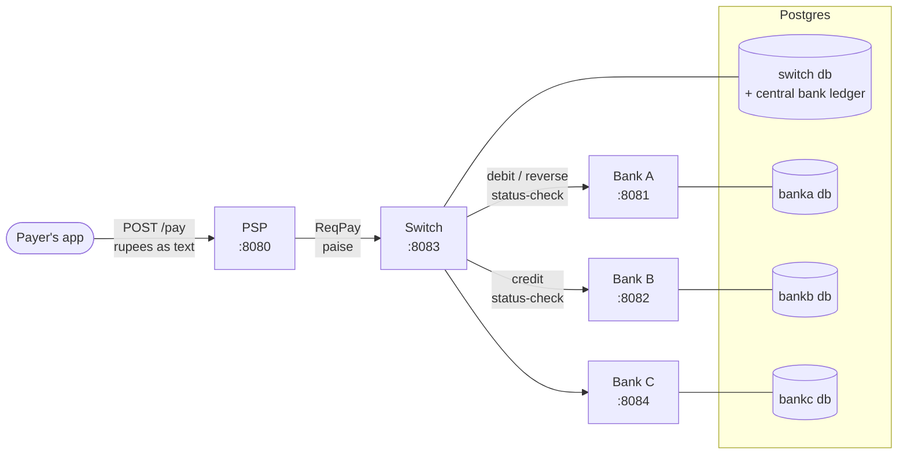
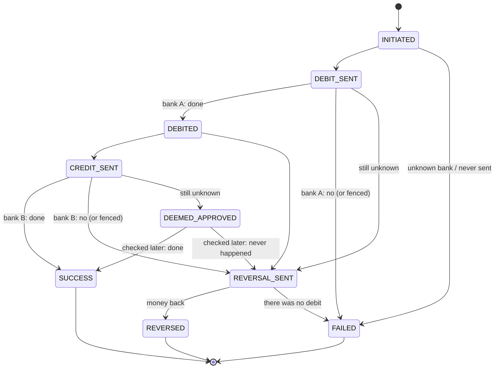

# PaySwitch

A UPI-style payment switch **simulator**: a payer's app, a switch and three banks that move money
between each other safely, even when the network loses messages or a bank stops answering, and
then settle up with each other through a central bank.
Java 21, Spring Boot 3, PostgreSQL, Docker Compose.

> **Disclaimer:** PaySwitch is a learning project and a simulator. It is not affiliated with NPCI,
> UPI or any bank, it does not connect to any real bank or payment network, and it moves no real money.

## Architecture



| Service | Job |
|---|---|
| **PSP** | The payer's app backend. Validates the request, turns rupees into paise (the only place that happens), makes a txnId. |
| **Switch** | Finds each bank from the VPA handle (`@banka`, `@bankb`, `@bankc`), runs the payment as a state machine, resolves every unclear bank answer, reconciles with the banks and settles cycles. |
| **Bank A / B / C** | The same app run three times. A double-entry ledger with idempotent debit, credit and reverse. |
| `ledger-core` | The double-entry rules in plain Java, with no Spring or database. |

## A payment's life (the switch's state machine)



Each state is saved **before** the bank is called, so after a crash the database says exactly
which bank to ask about what. Payments that stop moving are picked up by a background job, and
once when the switch starts (crash recovery).

| State | Where is Ravi's Rs 200? | Customer sees |
|---|---|---|
| INITIATED | With Ravi | PENDING |
| DEBIT_SENT | Not known yet: with Ravi, or in Bank A's settlement account | PENDING |
| DEBITED | In transit (Bank A settlement) | PENDING |
| CREDIT_SENT | In transit, or already with Anu | PENDING |
| DEEMED_APPROVED | Believed with Anu; checked again later | PENDING |
| REVERSAL_SENT | In transit, or already back with Ravi | PENDING |
| SUCCESS | With Anu | SUCCESS |
| FAILED | With Ravi (it never left) | FAILED |
| REVERSED | With Ravi (it left and came back) | REVERSED |

## Run it

You only need Docker.

```bash
docker compose up --build -d
```

Ravi (Bank A, starts with Rs 5,000) pays Rs 200 to Anu's shop (Bank B, starts with Rs 1,000):

```bash
curl -X POST http://localhost:8080/pay -H "Content-Type: application/json" \
  -d '{"payerVpa":"ravi@banka","payeeVpa":"anu@bankb","amount":"200.00"}'
```

```json
{"txnId":"TXN3F2A...","state":"SUCCESS","reason":"CREDIT_OK"}
```

On Windows PowerShell, use `curl.exe --%` with the JSON quotes escaped:

```powershell
curl.exe --% -X POST http://localhost:8080/pay -H "Content-Type: application/json" -d "{\"payerVpa\":\"ravi@banka\",\"payeeVpa\":\"anu@bankb\",\"amount\":\"200.00\"}"
```

Look around (balances are in paise):

```bash
curl http://localhost:8080/pay/TXN3F2A...              # the payment's status
curl http://localhost:8083/txns/TXN3F2A...             # every step, with the reason for each
curl http://localhost:8081/accounts/ravi@banka/balance # 480000
curl http://localhost:8082/accounts/anu@bankb/balance  # 120000
```

Bank C (port 8084) has Kumar (`kumar@bankc`, Rs 4,000) and Priya (`priya@bankc`, Rs 2,500).

Stop with `docker compose down`; `docker compose down -v` also resets every balance (and is needed
once after upgrading, so Postgres creates the new `bankc` database).

## Chaos mode: make the banks unreliable

All banks run with the `chaos` profile, so `/admin/chaos` exists. Every rate starts at 0.

| Setting | What the bank does to /debit, /credit, /reverse |
|---|---|
| `declineRate` | answers DECLINED without doing anything |
| `errorRate` | answers HTTP 500 without doing anything |
| `delayMs` | waits this long first |
| `dropResponseRate` | **does** the operation, commits it, then stays silent past the switch's timeout |
| `statusErrorRate` | answers HTTP 500 to `/status-check` |
| `seed` | repeat the same random decisions every time |

Example: Bank A does every debit but never replies. The payment still ends in `SUCCESS`, about
5 seconds later: the switch times out, asks Bank A what happened, finds the debit, and carries on.

```bash
curl -X POST http://localhost:8081/admin/chaos -H "Content-Type: application/json" -d '{"dropResponseRate":1.0}'
curl -X POST http://localhost:8080/pay -H "Content-Type: application/json" \
  -d '{"payerVpa":"ravi@banka","payeeVpa":"anu@bankb","amount":"200.00"}'
curl -X POST http://localhost:8081/admin/chaos -H "Content-Type: application/json" -d '{}'   # chaos off
```

## Settlement: who pays whom at the end of the day

During the day no real money moves between banks. Each bank only records "I owe the switch"
or "the switch owes me" in its `SWITCH_SETTLEMENT` account. Periodically the switch closes a
**settlement cycle** and banks pay only their **net** position (receives minus pays):

| Payments in the cycle | Bank A | Bank B | Bank C |
|---|---|---|---|
| A -> B Rs 10,000 | -10,000 | +10,000 | |
| B -> C Rs 6,000 | | -6,000 | +6,000 |
| C -> A Rs 4,000 | +4,000 | | -4,000 |
| **Net position** | **-6,000** | **+4,000** | **+2,000** |

Gross Rs 20,000, but only Rs 6,000 actually moves (70% saved). The positions always sum to zero;
the switch checks that, and a cycle that does not add up is marked FAILED and never settled.

Only payments that are SUCCESS **and** confirmed by reconciliation join a cycle. DEEMED_APPROVED
payments and reconciliation exceptions wait for a later cycle.

```bash
curl -X POST http://localhost:8083/admin/settlement/close        # close + settle the open cycle
curl http://localhost:8083/admin/settlement/cycles/1             # items, net positions, gross vs net
curl http://localhost:8083/admin/settlement/central/reserves     # each bank at the central bank
```

Settling posts one journal entry in the central bank's ledger (same `ledger-core` rules), then
sends each bank `POST /settlement/advice`, which moves the amount from `SWITCH_SETTLEMENT` to
its `CENTRAL_BANK_RESERVE`. Every step is idempotent by cycle id.

## Design decisions

| Decision | Why |
|---|---|
| Money is `long` paise; rupees only at the PSP, with `BigDecimal` | `double` cannot hold most decimal amounts exactly. A decimal amount anywhere else is refused. |
| Double-entry ledger: every entry's lines sum to zero | Money can only move, never appear or vanish, and an audit query can prove it. |
| Every bank operation is idempotent by (txnId, operation) | Retries are unavoidable on a network; they must never debit or credit twice. |
| Claim, money and saved answer in ONE database transaction | A crash between them can never leave "money moved but no record", or the reverse. |
| `SELECT ... FOR UPDATE` on account rows, locked in id order | Stops lost updates; one fixed lock order makes deadlocks impossible. |
| A per-txnId advisory lock in the bank | A late request and a status check or reversal for the same txnId can never interleave. |
| Payment = state machine; every change is an audit-trail row | Illegal moves are impossible, and every payment's history can be read back step by step. |
| Optimistic locking (`version`) in the switch | The switch waits seconds for banks; holding a database lock that long would block everyone. |
| State saved BEFORE each bank call | After a crash, the saved state says which bank to ask about what. |
| Every bank answer is SUCCESS, DECLINED or UNKNOWN, decided in one class | A timeout is not a failure. Only a clear answer from the bank counts. |
| Status check with fencing | "No record" becomes a promise the request will never run later, so FAILED is safe to say. |
| Unknown debit, so reverse; unknown credit, so never reverse (DEEMED_APPROVED) | Reversing a debit is safe either way; reversing a credit that did happen would create money. |
| Retries with exponential backoff and jitter | Gives a struggling bank room to recover, and spreads retries so they do not all land at once. |
| Background resolver with `FOR UPDATE SKIP LOCKED` and a lease | Many copies of the switch can run it at once without ever handling the same payment twice. |
| Multilateral net settlement of reconciled payments only | Far less money moves between banks, and nothing is settled that the banks' own books do not confirm. |

## Tests

```bash
mvn test
```

Needs Docker: the tests start a real PostgreSQL with Testcontainers. Coverage reports are written
to each module's `target/site/jacoco/index.html`.
