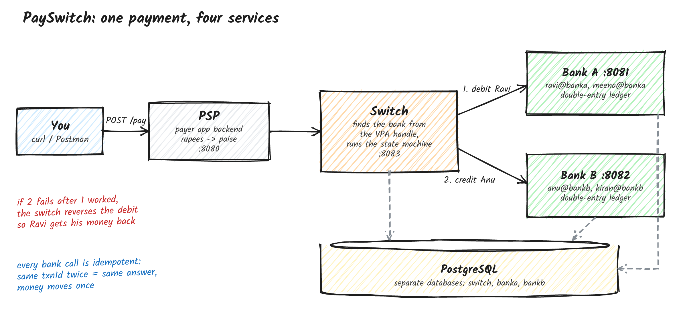
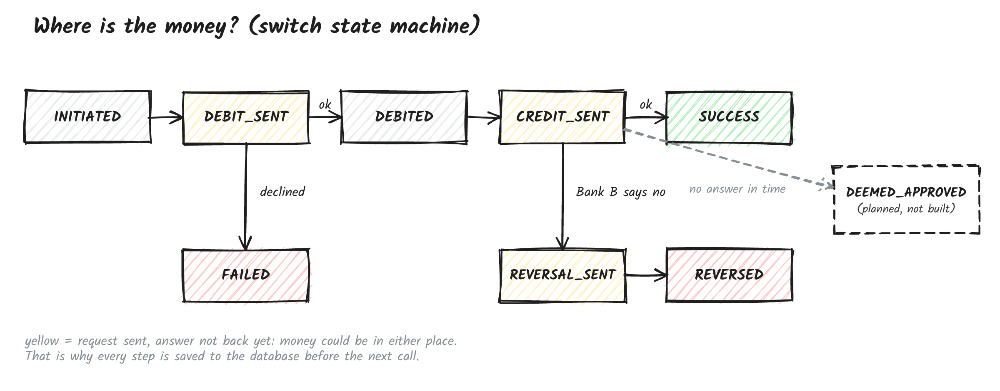

# PaySwitch

A small UPI-style payment switch, built to learn how money moves between two banks when you pay someone with UPI.

Java 21, Spring Boot 3, PostgreSQL, Docker Compose. It's a simulator: no real money and no real banks.

## How it works



Say Ravi (Bank A) pays Rs 200 to Anu (Bank B):

1. The **PSP** (the payer's app backend) checks the request and converts rupees to paise.
2. The **Switch** looks at the VPA handle (`@banka`, `@bankb`) to find each bank.
3. It asks Bank A to **debit** Ravi.
4. Then it asks Bank B to **credit** Anu.
5. If the credit fails after the debit worked, the switch **reverses** the debit so Ravi gets his money back.

Each bank keeps a double-entry ledger, so money is never created or lost, only moved between accounts.

## Where is the money at each step?



The switch tracks every payment as a state machine and saves each state **before** calling a bank. So if it crashes halfway, the database shows exactly where the payment stopped.

Bank calls are idempotent: if the same request reaches a bank twice, the bank gives the same answer and the money only moves once.

## Run it

You only need Docker running.

```bash
docker compose up --build
```

Make a payment:

```bash
curl -X POST http://localhost:8080/pay -H "Content-Type: application/json" \
  -d '{"payerVpa":"ravi@banka","payeeVpa":"anu@bankb","amount":"200.00"}'
```

```json
{"txnId":"TXN3F2A...","state":"SUCCESS","reason":"CREDIT_OK"}
```

Check balances (in paise):

```bash
curl http://localhost:8081/accounts/ravi@banka/balance   # 480000
curl http://localhost:8082/accounts/anu@bankb/balance    # 120000
```

Other things to try:

| Payment | What happens |
|---|---|
| `meena@banka` pays `"99999"` | `FAILED`, not enough money, nothing moves |
| `ravi@banka` pays `ghost@bankb` | `REVERSED`, Ravi is debited, Bank B refuses, Ravi gets refunded |
| `ravi@banka` pays `anu@nobank` | `FAILED`, unknown bank, no bank is called |

## Tests

```bash
mvn test
```

Needs Docker, because the tests start a real PostgreSQL with Testcontainers.

## What's not done yet

- Bank timeouts aren't handled yet. `DEEMED_APPROVED` (Bank B didn't answer in time) is in the state machine but nothing uses it
- No login or API keys
- No UI, it's API only
