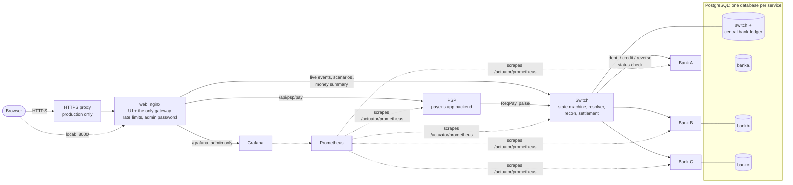
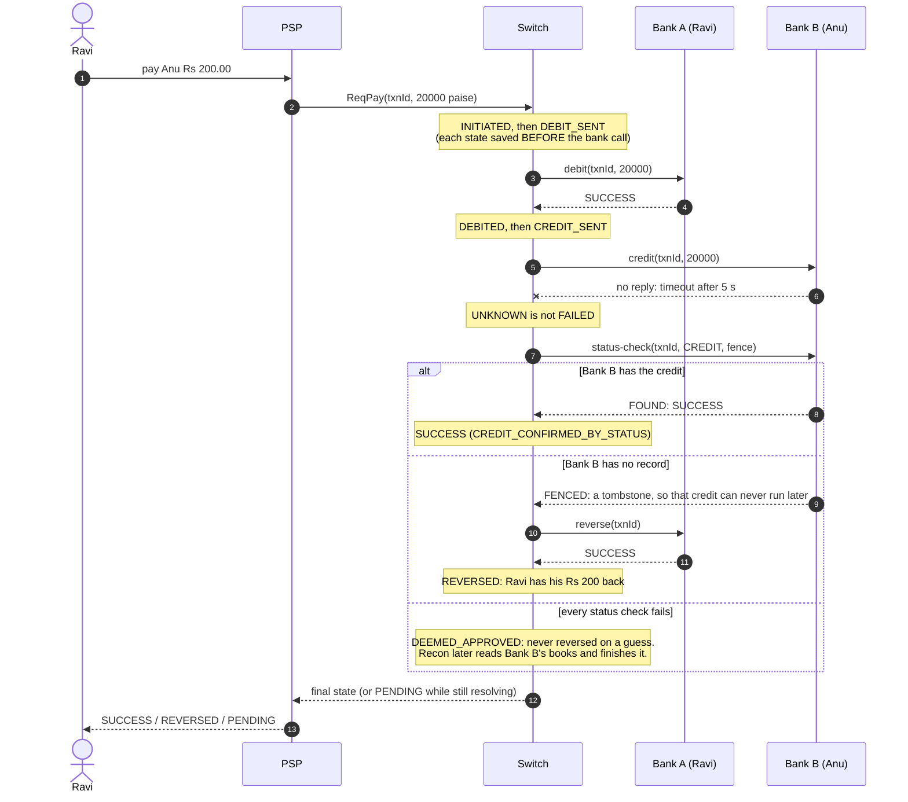
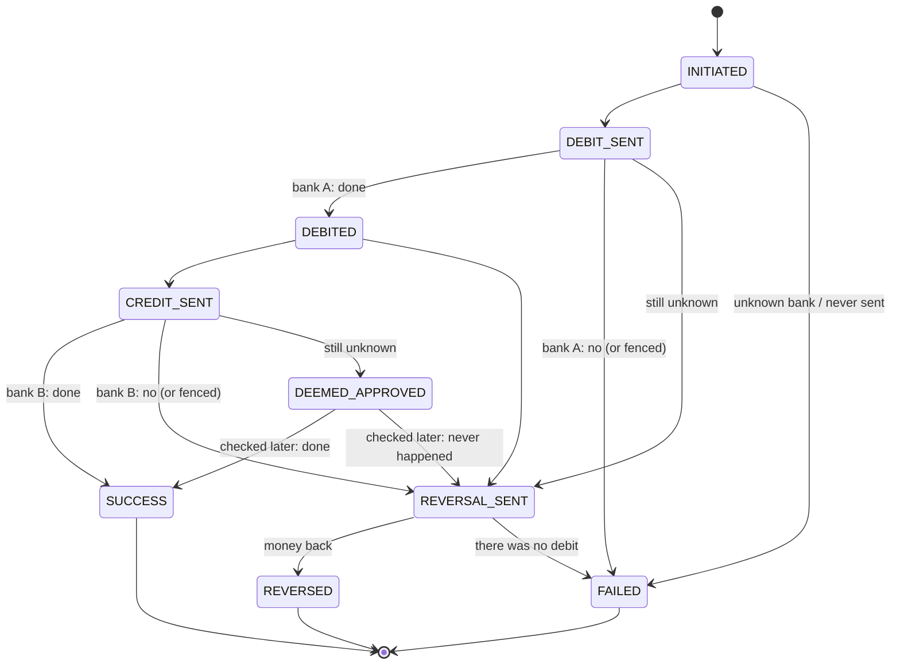

# PaySwitch

**A UPI-style payment switch simulator that never loses a paisa, even when banks time out, replies get lost
and the switch itself crashes mid-payment.** Java 21, Spring Boot 3, PostgreSQL, Docker Compose.

[](https://github.com/sanjeevveerapandian/payswitch/actions/workflows/ci.yml)

**Live demo:** _coming soon_ <!-- replace with the deployed URL, e.g. https://payswitch.example.com -->

<!-- Demo recording: add docs/images/demo.gif and replace this comment with
      -->
> _Screenshot / GIF of the live demo: to be added (`docs/images/demo.gif`)._

### Headline result

Three runs of 1,00,000 payments each, sent through the PSP, then checked by the `MoneyAuditor`
reading every database directly. **All three runs: RESULT: PASS. Not one paisa was created or lost.**

(Details, numbers and what this does not prove: [Results](#results) and [RESULTS.md](RESULTS.md).)

> **Disclaimer:** PaySwitch is a learning project and a **simulator**. It is not affiliated with NPCI or any
> bank, does not connect to any real bank or payment network, moves **no real money**, and uses no NPCI or
> UPI names, logos or marks as its own.

---

## What happens when you pay

1. Ravi's payment app (the **PSP**) sends "Ravi pays Anu's shop Rs 200" to the **switch**, the hub between banks.
2. The switch asks **Ravi's bank** to take Rs 200 out of Ravi's account (a debit).
3. It then asks **Anu's bank** to put Rs 200 into Anu's account (a credit). Both banks keep double-entry books.
4. If a bank does not answer, the switch **asks what happened** instead of guessing, and finishes or refunds the payment.
5. At the end of a cycle the banks **settle** with each other through a central bank: only the net amount moves.

## Architecture



| Service | Job |
|---|---|
| **web** | nginx: serves the demo UI and is the only way in. Public routes are an allow-list; everything admin needs a password; requests are rate limited. |
| **PSP** | The payer's app backend. Validates the request, turns rupees into paise (the only place that happens), makes the txnId. |
| **Switch** | Routes by VPA handle (`@banka`, `@bankb`, `@bankc`), runs each payment as a state machine, resolves unclear bank answers, reconciles with the banks, settles cycles. |
| **Bank A / B / C** | One app run three times. A double-entry ledger with idempotent debit, credit and reverse, and a status check that can fence. |
| `ledger-core` | The double-entry rules in plain Java: no Spring, no database. |
| `observability` | The txnId filter, header interceptor and log context every service shares. |
| Prometheus + Grafana | Metrics from every service, one provisioned dashboard, three alert rules. |

## A payment, including a failure

Bank B credits Anu but its reply never arrives. A timeout is not a "no", so the switch asks:



## The state machine



| State | Where is Ravi's Rs 200? | Ravi sees |
|---|---|---|
| INITIATED | With Ravi | PENDING |
| DEBIT_SENT | Not known yet: with Ravi, or in Bank A's settlement account | PENDING |
| DEBITED | In transit (Bank A's settlement account) | PENDING |
| CREDIT_SENT | In transit, or already with Anu | PENDING |
| DEEMED_APPROVED | Believed with Anu; checked again later | PENDING |
| REVERSAL_SENT | In transit, or already back with Ravi | PENDING |
| SUCCESS | With Anu | SUCCESS |
| FAILED | With Ravi (it never left) | FAILED |
| REVERSED | With Ravi (it left and came back) | REVERSED |

## Design decisions, and why

| Decision | Why |
|---|---|
| **Money is `long` paise, never `double`** | `0.1 + 0.2` is not `0.3` in floating point; money must be exact. Rupees exist only at the PSP's edge, parsed with `BigDecimal`. A decimal amount anywhere else is refused, not rounded. |
| **Double-entry ledger: every entry's lines sum to zero** | Money can only move between accounts, never appear or vanish, and one SQL query can prove it. Enforced in `ledger-core` and checked by an audit query after tests. |
| **Idempotency key (txnId, operation) saved in the SAME transaction as the money** | Retries are unavoidable on a network. Claiming the key, moving the money and saving the answer commit together, so a crash can never leave "money moved but no record" (a retry would debit twice) or the reverse. A repeat gets the saved answer. |
| **`SELECT ... FOR UPDATE` in the banks; optimistic locking in the switch** | A bank transaction is milliseconds long, so locking the account rows (in id order: no deadlocks) is simple and stops lost updates. The switch waits seconds for banks; holding a lock that long would block everyone, so it uses a `version` column and retries on conflict instead. |
| **UNKNOWN is not FAILED** | A timeout, an HTTP 500 or a lost reply means "I don't know". Treating it as FAILED would refund a debit that actually happened (money created) or tell Ravi "failed" for a payment Anu received. Every bank answer is classified SUCCESS, DECLINED or UNKNOWN in one place. |
| **Status check with fencing, and tombstones** | "No record" alone proves nothing: the original request may still arrive later. So the status check also writes a FENCED tombstone for that (txnId, operation); if the late request arrives, it is refused. Only then is FAILED safe to say. |
| **Unknown debit: reverse. Unknown credit: never reverse (DEEMED_APPROVED)** | Reversing a debit is safe whether or not it happened: if it never did, the bank answers NO_DEBIT and blocks that debit from ever running later. Reversing a credit that did happen would pay Ravi back while Anu keeps the money: money created. So an unconfirmable credit waits. |
| **Reconciliation** | The switch's records and each bank's books are compared txnId by txnId, window by window. It finishes DEEMED_APPROVED payments from the bank's own books and flags any disagreement for a human. |
| **Multilateral net settlement, of reconciled payments only** | Banks pay only their net position each cycle (the positions always sum to zero), so far less money moves; in the 1 lakh runs netting saved 98.6-99.6% of the gross. Nothing settles that the banks' books do not confirm. |
| **Live events published AFTER the database commit** | `@TransactionalEventListener(AFTER_COMMIT)`: a browser must never see a state that is later rolled back. Sent over Server-Sent Events, batched every 200 ms. |
| **No high-cardinality metric labels** | Every label combination is its own time series. A txnId, VPA or amount label would create one per payment and sink Prometheus. Labels are small fixed sets (state, bank, op); one payment is found in the logs by its txnId instead. |
| **One gateway, an allow-list of public routes** | One origin for the browser (no CORS), one port to expose. A bank's own `/credit` endpoint is never public; admin routes need a password; requests are rate limited. |

## Testing

| Layer | What | How |
|---|---|---|
| Unit | Ledger rules, the state machine, the bank-answer classifier, retry timing, net positions, reseed planning, chaos rules | Plain JUnit 5, no Spring where possible (`ledger-core` has no Spring at all) |
| Integration | Each service against a **real PostgreSQL** | Testcontainers. Concurrency tests (parallel debits on one account, the same txnId at once), crash points, recon, settlement |
| End to end | PSP, switch and three banks talking real HTTP in one JVM | `e2e-tests`: every scenario, chaos, crash and restart, reconciliation, settlement |
| Chaos + auditor | 5,000 payments with chaos in every `mvn verify` (`LoadChaosIT`); 1,00,000 in the big runs | The load generator, then the **money auditor** reads every database directly |

The auditor trusts no service API. It reads the four databases with SQL and checks:

1. total customer money unchanged;
2. no payment left unfinished;
3. no txnId debited or credited twice;
4. every outcome matches the money moved (SUCCESS = exactly one debit and one credit; FAILED/REVERSED = zero net effect);
5. every customer's balance is explained by the switch's final states;
6. settlement squared up (every bank's settlement account back to 0, central ledger balanced, net positions sum to 0);
7. no reconciliation exceptions;
8. no customer was told a final answer that later changed.

### Bugs found by the chaos test

From [RESULTS.md](RESULTS.md):

1. **Recon could skip payments and still say COMPLETED (real bug, switch-service).** Recon asked "which payments
   are old enough?" and later "how many were too new?", each with its own `now()`; payments in between were counted
   nowhere. Found because check 6 failed: 157 payments were never reconciled. Fixed with one horizon per run, taken
   once from the database clock; `ReconHorizonTest` failed on the old code and passes now.
2. **Seed script overflow (test harness).** `285 * 20000000` overflowed a 32-bit `INTEGER` in Postgres. Fixed
   with `::bigint`: a good reminder of why money is `long`.
3. **Payments sent before the PSP was up (test harness).** The generator now waits for `/actuator/health`.
4. **The auditor gave up during a long recon (test harness).** Recon calls now retry until a deadline.

Run them:

```bash
mvn test       # unit + integration + end to end (needs Docker for Testcontainers)
mvn verify     # also the 5,000 payment chaos test (about 2 more minutes)
```

CI runs `mvn verify` and builds every Docker image on each push and pull request.

## Results

One laptop: AMD Ryzen 5 5625U (6 cores / 12 threads), 15.4 GB RAM, Windows 11, Docker Desktop on WSL2 with
12 CPUs and 7.4 GiB given to Docker. The load generator, all five services and one Postgres ran on it together.
50 payments in flight; seed 42; chaos = 5% declines, 3% HTTP 500, 2% dropped replies, 5% failing status
checks and 0-300 ms random delay on every bank.

| | Run A: no chaos | Run B: chaos | Run C: chaos + switch crash at 50% |
|---|---|---|---|
| **Money audit** | **PASS** | **PASS** | **PASS** |
| Final SUCCESS | 98,671 | 83,530 | 82,034 |
| Final FAILED | 1,329 | 9,252 | 9,159 |
| Final REVERSED (payer refunded) | 0 | 7,218 | 7,207 |
| Never reached the switch (HTTP 502, no money moved) | 0 | 0 | 1,600 |
| Recon exceptions | 0 | 0 | 0 |
| TPS (50 concurrent) | 179 | 91 | 93 |
| Latency p50 / p95 / p99 | 254 / 558 / 858 ms | 350 / 826 / 5,340 ms | 338 / 797 / 5,324 ms |
| Settlement: saved by netting | 99.26% | 98.58% | 99.57% |

**What this does NOT prove** (in full in [RESULTS.md](RESULTS.md)):

- **TPS is not a capacity number.** It is 50 waiting clients on one laptop shared with everything else
  (TPS = concurrency / latency). Chaos latency is mostly the injected delays and the 5 s bank timeout.
- Correctness only for these seeded runs: other seeds, timings or much higher concurrency were not tested.
- Only the switch was killed. A bank or Postgres crash, disk loss and real network partitions were not tested.
- One switch instance ran, so two switches racing on the same payments at this scale was not tested.
- Nothing about real-world performance: simulated banks, one machine, no TLS, no real bank latency.

## Run it locally

You only need Docker.

```bash
docker compose up -d --build --wait
```

| What | Where |
|---|---|
| Demo UI | http://localhost:8000 |
| Admin parts of the UI, `/api/admin/...`, Grafana | "Admin log in" in the UI; locally **admin / admin** |
| Grafana dashboard | http://localhost:8000/grafana/ |
| Every service's own port (debugging, load test) | add `-f docker-compose.dev.yml`: PSP 8080, banks 8081/8082/8084, switch 8083, Postgres 5433, Prometheus 9090 |

The demo: make a payment and watch it move through its states live; run the five scenarios (happy path,
insufficient funds, lost debit reply, unknown credit, switch crash); as admin, turn on chaos per bank, send
1,000 random payments, run recon, close settlement, or reseed the demo balances. The TOTAL at the top must
never change; if it ever does, it flashes red.

Ravi (Rs 5,000) pays Anu's shop (Rs 1,000) Rs 200 from the command line:

```bash
curl -X POST http://localhost:8000/api/psp/pay -H "Content-Type: application/json" \
  -d '{"payerVpa":"ravi@banka","payeeVpa":"anu@bankb","amount":"200.00"}'
curl http://localhost:8000/api/switch/txns/TXN...                         # every step, with its reason
curl -u admin:admin http://localhost:8000/api/admin/banka/accounts/ravi@banka/balance   # 480000 (paise)
```

Check the gateway end to end (headers, public vs admin routes, size and rate limits, the live stream):

```bash
scripts/smoke-gateway.sh
```

Other tools: `scripts/trace.sh TXN...` shows one payment's log lines from every container in time order;
the 1 lakh load test and the auditor are described in [RESULTS.md](RESULTS.md) and run with
`docker compose -f docker-compose.yml -f docker-compose.dev.yml -f docker-compose.loadtest.yml up --build -d`
then `java -jar load-generator/target/load-generator-0.1.0-SNAPSHOT-all.jar --count 100000 --chaos on`.

Stop with `docker compose down` (data kept) or `docker compose down -v` (balances reset).

**Deploying the public demo:** production images, limits and secrets are in `docker-compose.prod.yml` and
`.env.example`; step-by-step server setup with HTTPS is in [DEPLOY.md](DEPLOY.md).

## The public demo's protections

| Risk | Protection |
|---|---|
| Someone calls a bank's `/credit` directly | Not routed: only an allow-list of public URLs exists at the gateway; everything else is 404 |
| Someone changes chaos, runs load, recon or settlement | All under `/api/admin/` and `/grafana/`, behind HTTP basic auth (password from `.env`) |
| Floods | Per-address rate limits: `/pay` 10 per minute (burst 5), scenarios 4 per minute, at most 4 live streams; 16 KB request limit; short client timeouts |
| The crash scenario restarts the switch for everyone | Limited to once a minute in total, and only the scenario's own payment can trigger it |
| Two visitors' scenarios fight over the same chaos settings | One scenario at a time (others get "busy, try again in a few seconds"); each scenario takes back the chaos it set up |
| Chaos left on spoils the demo | Every bank's chaos switches itself off 5 minutes after the last change |
| The demo customers run out of money | A nightly reseed (and an admin button) moves money back between the six customers with ordinary payments. No money is added, so TOTAL does not change. |
| Script injection, framing | Strict Content-Security-Policy (only our own scripts), `X-Frame-Options: DENY`, `nosniff`; the UI escapes all text |
| Ports left open | Postgres, Prometheus and the services publish no ports; the gateway listens on 127.0.0.1 behind the HTTPS proxy |

## Project structure

```
common/            DTOs shared by the services (requests, responses, enums)
ledger-core/       double-entry rules, pure Java (no Spring, no database)
observability/     txnId filter, X-Txn-Id header interceptor, log context
bank-service/      the bank (run 3 times): ledger, idempotent operations, status check + fencing, chaos, recon feed
switch-service/    state machine, payment flow, resolver, recon, settlement, live events, demo scenarios
psp-service/       the payer's app backend: rupees -> paise, txnId, the demo's bulk load
load-generator/    the 1 lakh payment load test and the money auditor
e2e-tests/         the whole system in one JVM over real HTTP
web/               nginx gateway config + the plain HTML/CSS/JS demo UI
monitoring/        Prometheus config and alerts, Grafana provisioning and dashboard
scripts/           smoke-gateway.sh, trace.sh
Dockerfile         one production image definition for every Java service
docker-compose*.yml  local stack, dev ports, load test, production
```

## What I would do next

- **Keyset pagination for recon.** Recon over about 1 lakh payments takes about 4.5 minutes, mostly the banks
  paging with `OFFSET` (a known limitation in RESULTS.md).
- **Let the scheduled recon catch up windows it missed.** It runs with a fixed delay, so a slow run can push
  the next one past a window boundary and that window is never reconciled by the timer.
- **Run two switch instances.** The resolver already uses `SKIP LOCKED` and leases; the live stream and the demo
  lock would need Postgres `LISTEN/NOTIFY` (or Redis) and an advisory lock.
- **Crash a bank and Postgres, not only the switch**, and test with real network faults (e.g. Toxiproxy).
- **A transactional outbox** for events that must not be lost on a crash (the live view is best-effort today).
- **TLS and service-to-service authentication** inside the Docker network.
